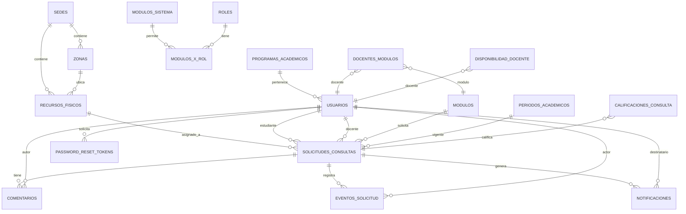

# Modelo Entidad-Relación

## PostgreSQL (Neon) - Dominio de negocio

El backend FastAPI gestiona el dominio en PostgreSQL. Tras las fases 1-3 se cuentan **19 tablas**. Las tablas de infraestructura física (`sedes`, `zonas`, `recursos_fisicos`) migraron desde MySQL a PostgreSQL y se relacionan con `solicitudes_consultas` mediante clave foránea (`recurso_fisico_id`).



**Tablas PostgreSQL (19):** `auditoria`, `calificaciones_consulta`, `comentarios`, `disponibilidad_docente`, `docentes_modulos`, `eventos_solicitud`, `modulos`, `modulos_sistema`, `modulos_x_rol`, `notificaciones`, `password_reset_tokens`, `periodos_academicos`, `programas_academicos`, `recursos_fisicos`, `roles`, `sedes`, `solicitudes_consultas`, `tipos_documento`, `usuarios`, `zonas`. Incluye `sedes`, `zonas`, `recursos_fisicos` con FK desde `solicitudes_consultas` (`recurso_fisico_id`).

## MySQL (Aiven) - Servicios externos

El microservicio Express gestiona únicamente los servicios externos (4 tablas). Esquema aprobado:

```mermaid
erDiagram
    SERVICIOS_EXTERNOS ||--o{ CONSULTAS_SERVICIO_EXTERNO : registra
    SERVICIOS_EXTERNOS ||--o{ FESTIVOS : origen
    SERVICIOS_EXTERNOS ||--o{ CORREOS_ENVIADOS : origen
    CONSULTAS_SERVICIO_EXTERNO ||--o{ FESTIVOS : traza
    CONSULTAS_SERVICIO_EXTERNO ||--|| CORREOS_ENVIADOS : traza

    SERVICIOS_EXTERNOS {
        BIGINT UNSIGNED id PK
        VARCHAR(80) nombre UK
        VARCHAR(255) url_base
        VARCHAR(255) descripcion
        TINYINT(1) estado
        TIMESTAMP creado
        TIMESTAMP actualizado
    }

    CONSULTAS_SERVICIO_EXTERNO {
        BIGINT UNSIGNED id PK
        BIGINT UNSIGNED servicio_id FK
        CHAR(36) referencia UK
        VARCHAR(255) endpoint
        SMALLINT codigo_http
        TINYINT(1) exito
        INT UNSIGNED duracion_ms
        VARCHAR(255) detalle
        TINYINT(1) estado
        TIMESTAMP creado
        TIMESTAMP actualizado
    }

    FESTIVOS {
        BIGINT UNSIGNED id PK
        BIGINT UNSIGNED servicio_id FK
        BIGINT UNSIGNED consulta_servicio_id FK "NULL"
        DATE fecha
        CHAR(2) pais
        VARCHAR(150) nombre
        SMALLINT anio
        TINYINT(1) estado
        TIMESTAMP creado
        TIMESTAMP actualizado
    }

    CORREOS_ENVIADOS {
        BIGINT UNSIGNED id PK
        BIGINT UNSIGNED servicio_id FK
        BIGINT UNSIGNED consulta_servicio_id FK "UK 1:1"
        VARCHAR(150) destinatario
        VARCHAR(200) asunto
        ENUM estado_envio "'ENVIADO','FALLIDO'"
        VARCHAR(255) respuesta_proveedor
        TINYINT(1) estado
        TIMESTAMP creado
        TIMESTAMP actualizado
    }
```

**Relaciones exactas:** `servicios_externos` → `consultas_servicio_externo` (1:N); `servicios_externos` → `festivos` (1:N); `servicios_externos` → `correos_enviados` (1:N); `consultas_servicio_externo` → `festivos` (1:N, nullable); `consultas_servicio_externo` → `correos_enviados` (1:1).

Ver detalles en [06-ModeloDatos.md](./06-ModeloDatos.md).
